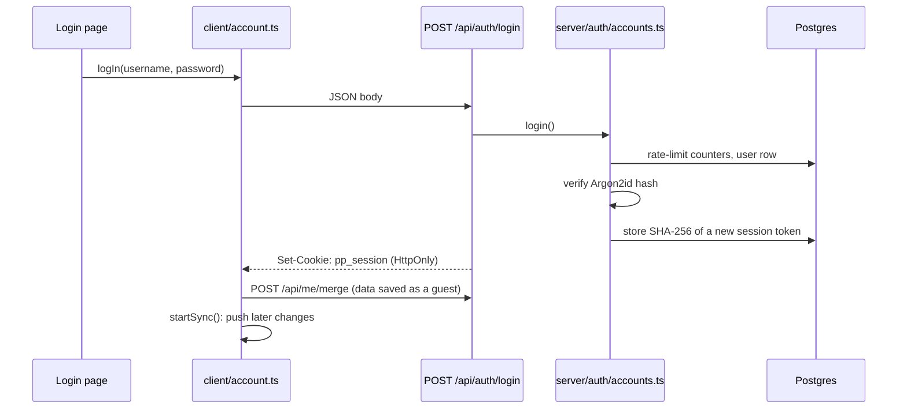

# Code walkthrough

This guide is a map for reading the code, or for presenting it to someone else. It starts with the folder layout, then follows five features from the button a person clicks to the code that answers. Each tour lists files in the order to open them.

## The layers

Every file lives in one of these folders, and the folder tells you where the code runs.

| Folder | Runs | What it holds |
|---|---|---|
| `src/data` | anywhere | The content: 89 pantry ingredients, the recipe schema, 250 recipes, weights and prices, default swaps |
| `src/lib` | anywhere | Pure logic with no React and no server: scaling, matching, filtering, nutrition, the shopping list, validation, API request handling |
| `src/i18n` | anywhere | English and Spanish: interface strings, ingredient names, recipe translations |
| `src/client` | browser only | State kept in the browser (pantry, plan, favorites), sign-in, sync, and calls to the API |
| `src/server` | server only | The database, passwords and sessions, and the chatbot. Each file starts with `import "server-only"`, so it can never end up in a browser bundle |
| `src/components` | browser | UI, grouped by feature: `browse`, `recipe`, `plan`, `pantry`, `auth`, `chat`, `my-recipes`, `layout` |
| `src/views` | server | The body of each page, shared by the English and Spanish routes |
| `src/app` | server | Next.js routes. `app/es/*` mirrors every English page, and `app/api/*` holds the API routes |

Dependencies point one way: `app` → `views` → `components` → `client` / `lib` → `data`. Code in `server` uses `lib` and `data` but never `client` or `components`.

## Tour 1: the content and its rules

Start here, because every other feature builds on this data.

1. **[src/data/pantry.ts](../src/data/pantry.ts)**: every ingredient a recipe may use. The tiers are `pantry` (food pantry staples), `extra` (seasonings like cumin), and `free` (water, ice). A `parent` lets a search for "beans" match "black beans".
2. **[src/data/schema.ts](../src/data/schema.ts)**: the recipe shape as a Zod schema. Ingredients are written as short tuples like `["milk", 0.5, "cup"]`, and the schema turns them into objects.
3. **[src/data/recipes/soups.ts](../src/data/recipes/soups.ts)**: one course's recipes, to see what real content looks like.
4. **[src/lib/validate.ts](../src/lib/validate.ts)**: the house rules. It rejects any recipe that uses an unknown ingredient, mentions an oven, puts an amount inside a step (it would not scale), or lists tools its steps don't use.
5. **[src/lib/catalog.ts](../src/lib/catalog.ts)**: loads every recipe through the schema, then adds what can be computed: diet labels, total time, nutrition, and cost.

`npm run build` runs the validator and the unit tests first (the `prebuild` script), so a recipe that breaks a rule fails the deploy.

## Tour 2: a recipe page

What happens when someone opens `/recipes/biryani` and changes the servings.

1. **[src/app/recipes/[slug]/page.tsx](../src/app/recipes/[slug]/page.tsx)**: the route. `generateStaticParams` lists all 250 slugs, so every recipe page is built once at deploy time.
2. **[src/views/RecipeView.tsx](../src/views/RecipeView.tsx)**: the page body. It picks the English or Spanish text (`localizeRecipe`) and renders the header.
3. **[src/components/recipe/RecipeBody.tsx](../src/components/recipe/RecipeBody.tsx)**: the interactive part. It holds the servings and the chosen swaps, and derives everything else from them.
4. **[src/lib/scale.ts](../src/lib/scale.ts)**: `scaleAmount` multiplies by servings ÷ base servings, then rounds to amounts you can measure (1/4, 1/3, 1/2, 2/3, 3/4) and steps units up or down (3 tsp becomes 1 tbsp).
5. **[src/lib/substitute.ts](../src/lib/substitute.ts)**: `resolveSubs` lists the swaps for one ingredient, and `applySub` rewrites the line.
6. **[src/lib/nutrition.ts](../src/lib/nutrition.ts)**: `gramsOf` turns any line into grams, using the weights in [src/data/facts.ts](../src/data/facts.ts). Calories, protein, fiber, and cost all come from those grams.
7. **[src/components/recipe/CookMode.tsx](../src/components/recipe/CookMode.tsx)** and **[src/lib/timers.ts](../src/lib/timers.ts)**: the full-screen cooking view, which finds "simmer for 10 minutes" in a step and offers a timer.

## Tour 3: search, filters, and the public API

Two ways in, one engine.

1. **[src/components/browse/RecipeBrowser.tsx](../src/components/browse/RecipeBrowser.tsx)**: the browse page. Filters live in the URL (`?course=soup&diet=vegan`), so a filtered view can be shared or bookmarked.
2. **[src/lib/filter.ts](../src/lib/filter.ts)**: `filterRecipes` applies every filter and sort. `parseFilters` and `serializeFilters` convert between the URL and a `FilterState`.
3. **[src/lib/match.ts](../src/lib/match.ts)**: "What can I make with only these?" `matchPantry` lists what a recipe is missing, and counts a missing item as covered when a swap you own fits.

The same engine answers the API:

4. **[src/app/api/recipes/route.ts](../src/app/api/recipes/route.ts)**: a three-line route handler.
5. **[src/lib/api/search.ts](../src/lib/api/search.ts)**: validates every query parameter with Zod, rejects unknown ones, and pages the results with a cursor.
6. **[src/lib/api/http.ts](../src/lib/api/http.ts)**: `handle()` wraps every route. Known errors become `{ error: { code, message, fields } }`; anything unexpected is logged and returned as a plain 500, so internals never leak.

The other endpoints follow the same pattern: [recipe-detail.ts](../src/lib/api/recipe-detail.ts) and [shopping-list.ts](../src/lib/api/shopping-list.ts). `/developers` shows the API docs, generated from [openapi.ts](../src/lib/api/openapi.ts), and a test keeps that document matching the real schemas.

## Tour 4: accounts and sync



1. **[src/components/auth/LoginForm.tsx](../src/components/auth/LoginForm.tsx)**: the form. It calls `logIn` and shows localized errors.
2. **[src/client/account.ts](../src/client/account.ts)**: who is signed in, plus `logIn`, `signUp`, `resetPassword`, and `logOut`.
3. **[src/server/route.ts](../src/server/route.ts)**: `publicRoute` and `authedRoute` wrap every account route. They block cross-site requests (Origin check), look up the session, and renew the cookie.
4. **[src/server/auth/accounts.ts](../src/server/auth/accounts.ts)**: signup, login, password reset, and account deletion, with input validation.
5. **[src/server/auth/crypto.ts](../src/server/auth/crypto.ts)**, **[session.ts](../src/server/auth/session.ts)**, and **[rate-limit.ts](../src/server/auth/rate-limit.ts)**: the security pieces.
   - **Passwords:** Argon2id hashing.
   - **Sessions:** a random token in an HttpOnly cookie, with only its SHA-256 stored.
   - **Recovery codes:** 8 one-time codes for resetting a password.
   - **Rate limits:** an atomic counter in Postgres.
6. **[src/client/sync.ts](../src/client/sync.ts)**: pages always read from browser storage. While you are signed in, each change is pushed to the account after 400 ms, and only when something actually changed.
7. **[src/server/user-data.ts](../src/server/user-data.ts)** and **[src/server/db/schema.ts](../src/server/db/schema.ts)**: how saved data is validated and stored.

## Tour 5: the kitchen helper (chatbot)

```mermaid
sequenceDiagram
  participant Page as chat/ChatView
  participant Route as POST /api/chat
  participant Loop as server/chat/loop.ts
  participant Claude as Claude API
  participant Tools as server/chat/tools/*
  Page->>Route: message
  Route->>Loop: runChatTurn()
  Loop->>Claude: whole conversation + 4 tools (streaming)
  Claude-->>Page: text as it is written (server-sent events)
  Claude->>Loop: tool_use: search_recipes {...}
  Loop->>Tools: validate input, run
  Tools-->>Page: recipe cards
  Loop->>Claude: tool results
  Claude-->>Page: final text
  Loop->>Loop: append every message to the stored conversation
```

1. **[src/components/chat/ChatView.tsx](../src/components/chat/ChatView.tsx)**: the page. `onEvent` turns each streamed event into an update on screen.
2. **[src/client/chat.ts](../src/client/chat.ts)**: `streamChat` reads the server-sent event stream.
3. **[src/app/api/chat/route.ts](../src/app/api/chat/route.ts)**: checks the request and turns `runChatTurn`'s events into a stream.
4. **[src/server/chat/loop.ts](../src/server/chat/loop.ts)**: the core loop. It calls the model, runs any tools it asks for, sends the results back, and repeats until the model answers. It handles refusals and cut-off replies, and stops after 6 steps.
5. **[src/server/chat/tools/](../src/server/chat/tools/index.ts)**: one file per tool. `index.ts` validates the model's input with Zod before running a tool, and returns failures to the model as errors.
6. **[src/server/chat/generate.ts](../src/server/chat/generate.ts)**: writes a new recipe as structured output, where ingredient IDs are an enum, so off-list ingredients are impossible. It then runs the catalog validator and sends any problems back to the model, up to 3 attempts.
7. **[src/server/chat/conversations.ts](../src/server/chat/conversations.ts)** and **[usage.ts](../src/server/chat/usage.ts)**: conversations are stored and replayed exactly, and each user has a daily message limit.

## Tests

| Kind | Where | What it covers |
|---|---|---|
| Unit | `tests/unit/*.test.ts` | Scaling, matching, filtering, nutrition, the shopping list, timers, validation, the API handlers, accounts against an in-memory Postgres, and the chat loop with a scripted fake model |
| Content | `tests/unit/catalog.test.ts` | All 250 recipes and their Spanish translations follow the rules |
| End to end | `tests/e2e/*.spec.ts` | Real browser flows against a production build, including chat through a mock Claude API ([mock-anthropic.ts](../tests/e2e/mock-anthropic.ts)) |

Run them with `npm test` and `npm run test:e2e`.
